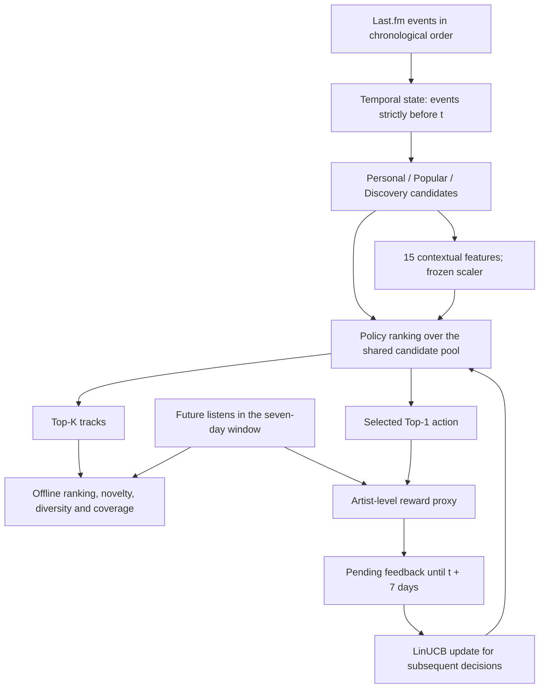
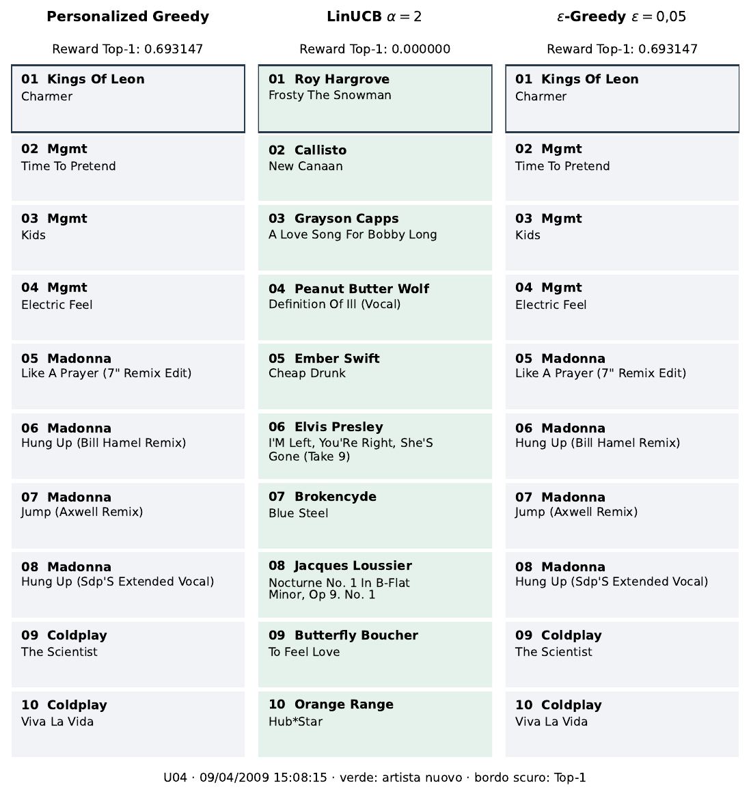

# Music Discovery CMAB

## Project Overview

Music Discovery CMAB studies the trade-off between personalization, exploration, and musical discovery through a **sequential offline simulation on Last.fm 1K**. A contextual bandit ranks previously observed tracks using listening history, popularity, recency, and novelty features. Four baselines provide comparisons within the same temporal environment and candidate pools.

The project includes a chronological simulator, delayed artist-level reward, resumable experiments, analysis notebooks, and a final academic report. It evaluates historical listening trajectories; it is not an online deployed recommender or an experiment with logged recommendation feedback.

**Start here:** [final report](report/music_discovery_cmab.pdf) · [analysis notebooks](#analysis-notebooks) · [frozen selection](experiments/configs/final_selection_manifest.json) · [setup](#getting-started)

## Key Findings

Official held-out results at **N=100**, across **562 users and 82,905 decision points**, ordered by NDCG@10. Parameters were selected on validation and frozen before the test.

| Policy | NDCG@10 | Average Reward | Track Novelty@10 | Artist Novelty@10 | Artist ILD@10 |
|---|---:|---:|---:|---:|---:|
| Personalized Greedy | 0.258795 | 0.973338 | 0.448135 | 0.000000 | 0.752957 |
| LinUCB, α=2.0 | 0.257741 | 0.913353 | 0.556484 | 0.101535 | 0.832490 |
| ε-Greedy, ε=0.05 | 0.248893 | 0.929997 | 0.469995 | 0.023193 | 0.764725 |
| Random | 0.058348 | 0.083866 | 0.881662 | 0.465040 | 0.993400 |
| Global Popularity | 0.036927 | 0.266868 | 0.650198 | 0.220333 | 0.000000 |

Source: [versioned summary derived from the official test aggregate](report/data/test_summary.csv); input hashes and run identifiers are recorded in [report provenance](report/data/provenance.json).

LinUCB recommends more unheard tracks and artists, with greater artist diversity than Personalized Greedy, while achieving numerically close NDCG@10 and lower Average Reward. The paired-user 95% bootstrap interval for the NDCG@10 difference, LinUCB minus Greedy, is **[−0.006601, +0.004389]**: this does not establish statistical equivalence. Reward is a logarithmic offline proxy, not a listening count or a causal measure of satisfaction.

### Reading the metrics

- **K denotes the Top-K tracks.** Precision, Recall, NDCG, and Artist Novelty use their distinct artists, preserving first occurrence. Track Novelty evaluates each track separately.
- **Artist ILD** measures pairwise artist differences across track positions; it does not measure acoustic or semantic distance.
- Decision-level metrics are averaged within users, then across users. **Coverage is a global union over the phase candidate catalog**, not a user mean.
- Results include K=5, 10, and 20. The unqualified `catalog_coverage` and `artist_coverage` aliases refer to **@20**, not @10; use explicit cutoff columns.

## Architecture



The offline evaluator accesses future listens; candidate generation and feature construction use only the strict past. Decisions at the same timestamp share the same pre-decision state.

Each source contributes up to **N tracks**, before deduplication; N is a source depth, not the final union size. Source flags are retained, with no fixed quotas:

| Source | Eligible tracks | Deterministic ordering |
|---|---|---|
| Personal | Heard tracks and unheard tracks by known artists | Canonical item key |
| Popular | Globally observed tracks | Observed item play count, then key |
| Discovery | Tracks unheard by the user, from familiar or new artists | Canonical item key |

The policies are Random, Global Popularity (artist play counts), Personalized Greedy (user–artist counts), ε-Greedy, and LinUCB. Only LinUCB learns from delayed rewards. Its context contains 13 standardized numerical features and two unchanged binary novelty flags; the baselines use their specified counts or randomization. See [simulation modules](src/simulation), [policy implementations](src/recommender/policies.py), and [runner documentation](src/experiments/README.md).

## Dataset and Preprocessing

Last.fm 1K contains **19,150,868 listening events from 992 users**. The official experiment retains **562 eligible users**, requiring at least ten warm-up events and ten usable decision points in each evaluation phase. Usable points require a nonempty candidate pool and a complete seven-day future window.

The loader reads six-column TSV records with literal quotation marks, handles missing IDs explicitly, and uses temporary SQLite storage for chronological ordering. A new session begins after a user-specific gap **strictly greater than ten minutes**; its first event defines the decision point. Observable history at time t contains only events with timestamps **< t**.

[Canonical identities](src/data/identity.py) distinguish artist IDs from exact-name fallbacks. An item combines its original track ID with its artist key, or its exact title with that artist key when the track ID is missing. This handles source track IDs attributed to different artists without order-dependent merging or arbitrary text normalization.

### Obtaining the data

The dataset is **not versioned**. Download `lastfm-dataset-1K.tar.gz` from [Òscar Celma / MTG's Zenodo record](https://zenodo.org/records/6090214), also linked by the [UPF Music Technology Group](https://www.upf.edu/web/mtg/software-datasets). Choose the **1K** archive; the same record also distributes the separate 360K dataset. Extract the original files under:

```text
dataset/lastfm-dataset-1K/
├── README.txt
├── userid-profile.tsv
└── userid-timestamp-artid-artname-traid-traname.tsv
```

The source is [Last.fm](https://www.last.fm/); its distribution specifies non-commercial use. Consult the archive's terms before reuse. The source README declares TSV MD5 `64747b21563e3d2aa95751e0ddc46b68`; this is distinct from the experiment's canonical event digest recorded in the selection manifest.

Historical experiment JSON files intentionally retain `Dataset/...` to preserve their hashes. Windows resolves this case difference. On a case-sensitive filesystem, create the documented local alias from the repository root:

```sh
ln -s dataset Dataset
```

Both paths are ignored by Git. Do not edit the frozen configuration paths to reproduce historical runs.

## Experimental Design

| Phase | Inclusive dates | Purpose |
|---|---|---|
| Warm-up | 2005-10-30 – 2008-12-31 | Chronological history and scaler fitting; no bandit updates |
| Validation | 2009-01-01 – 2009-02-28 | 36 configurations, parameter selection at N=100 |
| Held-out test | 2009-03-01 – 2009-05-05 | Five frozen policies, evaluated once |

**N=100 was documented as the primary environment before validation** in protocol commit `c7167312f55fdacd86e4183bfd80a3d1b02d5b55`. N=50 and N=200 are descriptive sensitivity analyses, not alternatives selected using their scores.

Validation evaluates α ∈ {0, 0.1, 0.25, 0.5, 1, 2} for LinUCB and ε ∈ {0.05, 0.10, 0.20} for ε-Greedy, plus the three other baselines at each N. Within each family at N=100, selection maximizes **NDCG@10**, then Average Reward, then prefers the lower parameter in an exact tie. The [manifest](experiments/configs/final_selection_manifest.json) freezes **α=2.0**, **ε=0.05**, seed **42** for the stochastic policies, and K=(5, 10, 20).

Top-1 reward is `ln(1 + future user listens to the selected artist)` in **(t, t+7 days]**. Only that action schedules feedback, available after seven days. The scaler is fitted exclusively on chronological warm-up contexts from all users and remains frozen. Each policy receives independent state; held-out history includes preceding listens, but no learned validation parameters or validation feedback are carried into the test.

The runner reuses one warm-up fit per N and replays history independently for subsequent policies. Persistent checkpoints store detailed JSONL, SHA-256 checksums, provenance, and atomic completion markers for verified resume. Full CSV/JSONL outputs and checkpoints remain outside Git.

Post-hoc uncertainty analysis uses **10,000 paired bootstrap resamples of the 562 users**, seed **20261022**, preserving each user's temporal observations. Reconstructed metrics match official aggregates within absolute tolerance 10⁻¹². Intervals are conditional on the recorded trajectories; they are not simultaneous guarantees across all comparisons.

## Repository Structure

```text
.
├── src/
│   ├── data/          # Canonical identities and incremental temporal state
│   ├── simulation/    # Candidates, contexts, scaling, LinUCB, reward, simulator
│   ├── recommender/   # Interchangeable ranking policies
│   ├── evaluation/    # Offline metrics and aggregation
│   └── experiments/   # Configuration, TSV loader, runner, CLI, checkpoints
├── experiments/
│   ├── configs/       # Frozen validation/test configuration and selection
│   └── FINAL_TEST_PROCEDURE.md
├── notebooks/         # Executed analyses and compact qualitative cache
├── report/            # Final PDF, LaTeX, figures, tables and derived summaries
├── docs/assets/       # README image derived from an existing report figure
└── tests/             # Unit and integration tests
```

## Getting Started

### Environment

The experimental environment used **Python 3.13**. The core simulator and tests use the Python standard library, including SQLite. Notebook analysis additionally uses NumPy, pandas, Matplotlib, Seaborn, IPython, and Jupyter. The tracked `requirements.txt.txt` is empty; dependencies are not currently version-pinned.

From the repository root, create an environment:

```sh
python -m venv .venv
```

Activate it with `source .venv/bin/activate` on Linux/macOS, or `.\.venv\Scripts\Activate.ps1` in Windows PowerShell. Then install the analysis tools and register the notebook kernel:

```sh
python -m pip install jupyterlab ipykernel numpy pandas matplotlib seaborn
python -m ipykernel install --user --name music-discovery-cmab --display-name "Python (Music Discovery CMAB)"
python -m src.experiments.cli --help
python -m jupyterlab
```

On Windows, point temporary-file handling at the ignored project directory before launching Python, as used during verification:

```powershell
New-Item -ItemType Directory -Force .pytest-tmp | Out-Null
$env:TEMP = $env:TMP = $env:TMPDIR = (Resolve-Path .pytest-tmp).Path
```

### What works from a clean clone?

- Read the PDF and saved notebook tables/plots without the dataset.
- Regenerate the qualitative section of notebook 02 from its verified, versioned cache, using the relevant cells only.
- Compile the report from its included figures and tables; see [report build instructions](report/README.md).
- Run the standard-library test suite with `python -m unittest discover -s tests`.

Full analysis recomputation needs the original dataset and/or official aggregate and checkpoint files, depending on the notebook. These large artifacts are not included; downloading Last.fm alone does not provide the historical experiment outputs. Small derived summaries and provenance are included in [report/data](report/data).

Full validation/test reproduction takes substantial CPU time and multiple gigabytes of temporary and persistent storage. It is separate from browsing the project or rendering qualitative examples. Consult the [runner documentation](src/experiments/README.md) and [frozen test start/resume procedure](experiments/FINAL_TEST_PROCEDURE.md) before deliberately reproducing an experiment; checkpoints are bound to dataset, configuration, and experiment code identity.

## Analysis Notebooks

| Notebook | Contents |
|---|---|
| [Dataset analysis](notebooks/01_dataset_analysis.ipynb) | Listening activity, concentration and descriptive dataset exploration. |
| [Reward/session exploration](notebooks/reward_sessions_split.ipynb) | Preliminary session, split and reward analysis; its older parser/cohort counts are not the final experimental reference. |
| [Validation analysis](notebooks/01_validation_analysis.ipynb) | All 36 runs, hyperparameter sweeps, N=100 comparisons and N sensitivity. |
| [Final test analysis](notebooks/02_final_test_analysis.ipynb) | Five frozen policies, validation/test differences, discovery trade-offs and five real qualitative examples. |
| [Statistical analysis](notebooks/03_statistical_analysis.ipynb) | Metric reconstruction, paired-user bootstrap intervals and effect-size interpretation. |

All retain executed outputs. [Notebook reproducibility notes](notebooks/README.md) distinguish sections runnable from a clean clone from those requiring external artifacts. In particular, recomputing the statistical reconstruction reads the full TSV; viewing its saved results does not.

## Qualitative Recommendations

One of five fixed examples compares the same user and timestamp across Personalized Greedy, LinUCB and ε-Greedy. This is an existing test output, not a newly generated recommendation.



**U04, 2009-04-09 15:08:15.** Green marks artists absent from the user's strict-past history; a dark outline marks Top-1. LinUCB's list differs substantially here, but its Top-1 proxy reward is zero. A single example illustrates list composition, not an overall performance claim.

The image is a PNG rendering of the [original report figure](report/figures/qualitative_U04.pdf). The [compact qualitative cache](notebooks/data/qualitative_examples.json), checked against its [SHA-256 sidecar](notebooks/data/qualitative_examples.json.sha256), contains five examples and 150 recommendations. It supports rendering without large result files or a dataset scan. Exact per-example **track** novelty is not reconstructed; aggregated Track Novelty remains available in the official metrics. [The cache-building script](notebooks/build_qualitative_cache.py) documents regeneration from existing official artifacts without rerunning policies.

## Technical Report

The final report, in Italian, develops the methodology, engineering choices, results, uncertainty analysis, and limitations:

- [Final PDF](report/music_discovery_cmab.pdf)
- [LaTeX entry point](report/main.tex) and [build instructions](report/README.md)
- [Sources, hashes and run provenance](report/data/provenance.json)

## Limitations

- **No logged exposures or propensity scores:** this is sequential offline simulation, not IPS/SNIPS evaluation or a randomized online trial.
- **Noncausal reward:** future historical listening is an artist-level proxy; it does not establish that a recommendation caused an interaction or improved satisfaction.
- **Retrospective eligibility:** cohort selection uses usable activity in both validation and test, conditioning findings on sufficiently active users.
- **Restricted generalization:** one historical Last.fm population, temporal split and stochastic seed do not establish robustness across populations, periods or retraining runs.
- **Candidate and feature constraints:** only previously observed items are recommendable; deterministic key ordering in two source pools can bias exposure. Contexts contain listening-derived features, without audio or semantic representations, and artist novelty is not necessarily perceptual discovery.
- **Inferential scope:** post-hoc user bootstrap intervals do not account fully for shared temporal shocks or the shared learner, and no multiple-comparison correction or equivalence test was performed.

## References

- Li et al. (2010). [A Contextual-Bandit Approach to Personalized News Article Recommendation](https://arxiv.org/abs/1003.0146).
- Celma (2010). [Last.fm 1K dataset, MTG/UPF distribution](https://zenodo.org/records/6090214).
- Järvelin and Kekäläinen (2002). [Cumulated Gain-Based Evaluation of IR Techniques](https://doi.org/10.1145/582415.582418).
- Vargas and Castells (2011). [Rank and Relevance in Novelty and Diversity Metrics for Recommender Systems](https://doi.org/10.1145/2043932.2043955).

See the [report bibliography](report/references.bib) for the full methodological references.
